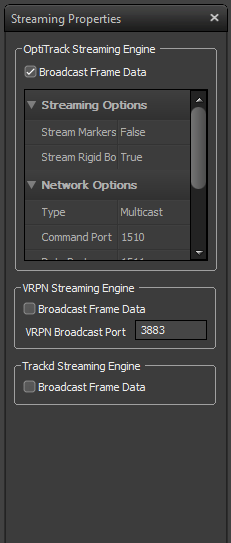
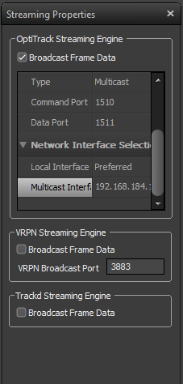
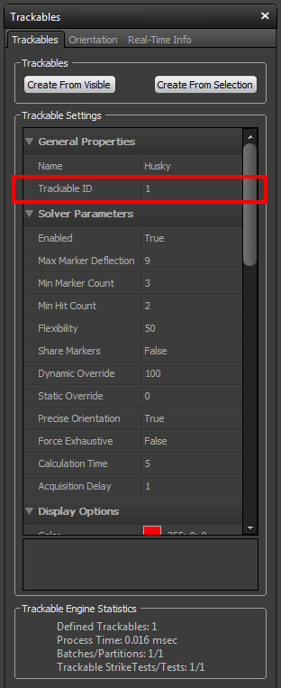

## Installation

The easiest way to get the mocap_optitrack package in Ubuntu is using
`apt-get`: 

```
$ sudo apt-get install ros-fuerte-mocap-optitrack
```


If you'd like to contribute to the package, feel free to check it out
from Github and submit pull requests.

To install Tracking Tools, see the instructions on the
[Natural Point website](http://www.naturalpoint.com/optitrack/downloads/tracking-tools.html).

## Configuring Tracking Tools

After installing Tracking Tools you will need to configure it for
streaming of rigid bodies to the (virtual)machine running the
mocap_optitrack ROS node.

1\. Open the "Streaming Properties" pane in Tracking Tools and enable
the "Broadcast Frame Data" checkbox. Set the "Stream Rigid Bodies"
option to "True" if it's not set already. 1. Set "Type" to
"Multicast", the ports should be left as-is. 1. Unless the machine
running Tracking Tools has multiple network interfaces, the "Local
Interface" may be set as "Preferred". The "Multicast Interface"
should be set to the address of the machine running the mocap_optitrack
node. 


## Configuring mocap_optitrack

Once motion capture data is being streamed to the mocap_optitrack node,
the mapping of trackables to ROS topics must be defined. A sample
configuration file called "mocap.yaml" is included with the package,
you can find it in the config directory of the package.


```
$ roscd mocap_optitrack/config
$ vi mocap.yaml
```


### Selecting Rigid Bodies to Publish

Since multiple robots may be tracked by the OptiTrack system, the
mocap_optitrack configuration allows for publishing poses and transforms
for each robot separately.

First, the robot must be set up as a trackable in Tracking Tools - see
the
[Tracking Tools documentation](http://www.naturalpoint.com/optitrack/static/documents/Tracking%20Tools%202.4.0%20User%20Guide.pdf)
for how to do this.

Next, note the Trackable ID for each trackable in Tracking Tools.



The published topics for each trackable can now be configured in
mocap_optitrack. Each trackable that should be published in ROS can be
specified by its Trackable ID - the desired topics for the published
Pose, 2D Pose and the frame_id of the transform in tf can be configured.


```
rigid_bodies:
    '1':
        pose: Robot_1/pose
        pose2d: Robot_1/ground_pose
        frame_id: Robot_1/base_link
    '2':
        pose: Robot_2/pose
```

 If any of the topics is left unconfigured,
nothing will be published for that datatype. E.g. for trackable "2",
no pose2d or frame_id is configured so no Pose2D or TF messages will be
published.

## Further reading

The specifications of the !NatNet streaming protocol may be downloaded
from the
[Natural Point website](http://media.naturalpoint.com/software/OptiTrack_files/NatNetSDK2.2.zip)
